# RDO — Etapa D2
## Modelo entidade-relacionamento e especificação SQL para SQLite

**Versão:** 1.0 — proposta para revisão  
**Status:** especificação; não aplicada ao repositório nem ao banco atual.

## 1. Objetivo e limites

Este documento transforma o dicionário consolidado da Etapa D em um modelo relacional implementável. O arquivo SQL complementar contém a proposta de criação do esquema para um banco novo.

**Importante:** o SQL é um *baseline* de referência, não uma migration pronta para executar sobre o banco existente. A migração do banco atual deverá ser escrita separadamente após inspeção do arquivo SQLite real, backup e validação da estrutura/dados atuais.

## 2. Decisões incorporadas

- Um projeto pode possuir várias unidades; uma unidade pode participar de vários projetos do mesmo cliente.
- Um RDO pertence a um projeto e pode registrar várias OS daquele mesmo projeto.
- Um RDO pode registrar uma ou várias unidades vinculadas ao projeto.
- O efetivo pode ser agregado por equipe, individual por trabalhador ou misto.
- Trabalhadores não precisam possuir conta de usuário.
- Empresas terceirizadas podem possuir usuários, trabalhadores e equipes.
- Assinaturas desenhadas são previstas inicialmente; integração certificada é uma evolução posterior.
- Mídias são armazenadas fora do SQLite; o banco guarda metadados e vínculos.
- Sincronização preserva versões e conflitos; não adota sobrescrita automática.

## 3. Modelo entidade-relacionamento

```mermaid
erDiagram
    CLIENTS ||--o{ UNITS : possui
    CLIENTS ||--o{ PROJECTS : contrata
    PROJECTS ||--o{ PROJECT_UNITS : utiliza
    UNITS ||--o{ PROJECT_UNITS : participa
    PROJECTS ||--o{ WORK_ORDERS : contem
    WORK_ORDERS ||--o{ ACTIVITIES : detalha
    WORK_ORDERS ||--o{ WORK_ORDER_ASSIGNMENTS : recebe
    ACTIVITIES ||--o{ ACTIVITY_ASSIGNMENTS : recebe
    ACTIVITIES ||--o{ ACTIVITY_DEPENDENCIES : depende
    PROJECTS ||--o{ PLANS : organiza
    PLANS ||--o{ PLAN_ITEMS : inclui
    ACTIVITIES ||--o{ PLAN_ITEMS : planejada

    PROJECTS ||--o{ FIELD_REPORTS : documenta
    FIELD_REPORTS ||--o{ FIELD_REPORT_UNITS : abrange
    FIELD_REPORTS ||--o{ FIELD_REPORT_WORK_ORDERS : registra
    WORK_ORDERS ||--o{ FIELD_REPORT_WORK_ORDERS : aparece
    FIELD_REPORTS ||--o{ FIELD_REPORT_TEAMS : mobiliza
    FIELD_REPORT_TEAMS ||--o{ FIELD_REPORT_WORKERS : detalha
    WORKERS ||--o{ FIELD_REPORT_WORKERS : participa
    FIELD_REPORTS ||--o{ FIELD_REPORT_ACTIVITIES : registra
    ACTIVITIES ||--o{ FIELD_REPORT_ACTIVITIES : executada
    FIELD_REPORTS ||--o{ OCCURRENCES : relata
    FIELD_REPORTS ||--o{ SIGNATURES : recebe
    FIELD_REPORTS ||--o{ FIELD_REPORT_EQUIPMENT : utiliza
    EQUIPMENT ||--o{ FIELD_REPORT_EQUIPMENT : alocado

    ORGANIZATIONS ||--o{ USERS : emprega
    ORGANIZATIONS ||--o{ WORKERS : disponibiliza
    ORGANIZATIONS ||--o{ TEAMS : organiza
    TEAMS ||--o{ TEAM_MEMBERS : possui
    WORKERS ||--o{ TEAM_MEMBERS : integra
    USERS o|--o| WORKERS : pode_corresponder

    FIELD_REPORTS ||--o{ FIELD_REPORT_CHECKLISTS : aplica
    CHECKLIST_TEMPLATES ||--o{ FIELD_REPORT_CHECKLISTS : instancia
    CHECKLIST_TEMPLATES ||--o{ CHECKLIST_ITEMS : define
    FIELD_REPORT_CHECKLISTS ||--o{ FIELD_REPORT_CHECKLIST_ANSWERS : recebe
    CHECKLIST_ITEMS ||--o{ FIELD_REPORT_CHECKLIST_ANSWERS : respondido

    MEDIA_FILES ||--o{ MEDIA_ATTACHMENTS : vincula
    USERS ||--o{ DEVICES : utiliza
    DEVICES ||--o{ SYNC_RECORDS : origina
    DEVICES ||--o{ SYNC_CONFLICTS : conflita
    USERS ||--o{ AUDIT_LOGS : executa
    USERS ||--o{ NOTIFICATIONS : recebe

    ROLES ||--o{ USER_ROLES : atribuido
    USERS ||--o{ USER_ROLES : possui
    ROLES ||--o{ ROLE_PERMISSIONS : autoriza
    PERMISSIONS ||--o{ ROLE_PERMISSIONS : compoe
    PROJECTS ||--o{ PROJECT_MEMBERSHIPS : libera
    USERS ||--o{ PROJECT_MEMBERSHIPS : acessa
```

### 3.1. Observações do MER

- `field_report_work_orders` é a entidade associativa que materializa o N:N entre RDO e OS.
- A associação inclui `project_id` para permitir FK composta e garantir que RDO e OS pertençam ao mesmo projeto.
- `project_units` materializa o N:N entre projetos e unidades e carrega `client_id` para validar que a unidade e o projeto pertencem ao mesmo cliente.
- `field_report_teams` registra a equipe e o modo de controle do efetivo naquele RDO.
- `field_report_workers` registra trabalhadores individualmente e aponta para a equipe registrada no mesmo RDO.
- `media_attachments` permite anexar mídia a diferentes tipos de registro. Como `entity_id` é polimórfico, a existência do registro pai precisa ser validada pelo serviço Go.
- `sync_records` e `audit_logs` também usam referência genérica (`entity_type` + `entity_id`); não possuem FK polimórfica para todas as tabelas.

## 4. Cardinalidades e regras principais

| Relação | Cardinalidade | Regra |
|---|---|---|
| Cliente → Unidades | 1:N | Unidade pertence a um cliente |
| Cliente → Projetos | 1:N | Projeto pertence a um cliente |
| Projeto ↔ Unidade | N:N | Via `project_units`; mesmo cliente |
| Projeto → OS | 1:N | OS pertence a um projeto |
| OS → Atividades | 1:N | Atividade pertence a uma OS |
| Projeto → RDO | 1:N | RDO pertence a um projeto |
| RDO ↔ OS | N:N | Via `field_report_work_orders`; mesmo projeto |
| RDO ↔ Unidade | N:N | Via `field_report_units`; unidade vinculada ao projeto |
| RDO → Equipes | 1:N | Uma equipe pode ter lançamentos distintos/turnos |
| Equipe do RDO → Trabalhadores | 1:N | Trabalhador identificado individualmente |
| RDO → Atividades executadas | 1:N | Permite lançamentos por equipe e sequência |
| RDO → Assinaturas | 1:N | Mais de um signatário |
| RDO → Checklists | 1:N | Diferentes modelos podem ser aplicados |

## 5. Decisões físicas de modelagem

### 5.1. Chaves e tipos
- Chaves primárias UUID em `TEXT`.
- Datas e timestamps em `TEXT` ISO-8601.
- Valores monetários em centavos (`INTEGER`).
- Percentuais em `REAL`, limitados entre 0 e 100.
- Booleanos em `INTEGER` com `CHECK (0,1)`.

### 5.2. Unidades e projetos
`project_units` armazena `client_id` além de `project_id` e `unit_id`. As FKs compostas asseguram que a unidade pertence ao mesmo cliente do projeto. Um índice único parcial permite apenas uma unidade principal por projeto.

### 5.3. Unidade da OS
A especificação assume que cada OS terá no máximo uma unidade específica (opcional). O campo `work_orders.unit_id` possui FK composta `(project_id, unit_id)` para `project_units`, garantindo que a unidade esteja vinculada ao projeto. Se uma OS puder abranger várias unidades, essa decisão deverá ser revista antes da migration e o campo deverá ser substituído por uma tabela associativa.

### 5.4. Efetivo
`field_report_teams.workforce_mode` determina o formato daquele lançamento:
- `aggregate`: `workers_count` obrigatório e não há trabalhadores detalhados nesse lançamento;
- `individual`: `workers_count` nulo e os trabalhadores são listados em `field_report_workers`.

No modo `both` do projeto, equipes diferentes podem usar modos diferentes no mesmo RDO. Não se deve somar `workers_count` de uma equipe individualizada. O serviço deverá validar que o modo utilizado é permitido pelo projeto.

### 5.5. Execução de atividades
`field_report_activities` permite vários lançamentos da mesma atividade no mesmo RDO, inclusive por equipes diferentes. `execution_sequence` diferencia segmentos repetidos. O SQL usa dois índices únicos parciais: um para lançamentos com equipe e outro para lançamentos sem equipe, pois `NULL` em índices UNIQUE do SQLite permite múltiplas linhas aparentemente duplicadas.

### 5.6. Mídias
`media_files` guarda apenas metadados. `media_attachments` relaciona a mídia ao registro de origem. A referência polimórfica não tem FK para a entidade de destino; o serviço deve validar o pai e a autorização do usuário antes de criar ou ler o vínculo.

### 5.7. Assinaturas
`signatures.signature_method` prevê `drawn`, `typed` e `certified`. A presença de `certified` no esquema não significa que a certificação esteja implementada. O fluxo futuro deve armazenar provedor, identificador externo, evidências e dados de verificação.

### 5.8. RDO fechado e histórico
A proteção de RDO aprovado/fechado não deve depender apenas de ocultar controles no frontend. O backend deverá bloquear alterações não autorizadas, registrar auditoria e definir um fluxo explícito de reabertura/retificação.

## 6. Índices

O SQL complementar propõe índices para:
- filtros por cliente e situação de projeto;
- OS por projeto e situação;
- atividades por OS e situação;
- RDO por projeto e data;
- OS vinculadas ao RDO;
- trabalhadores por RDO;
- ocorrências por projeto e situação;
- sincronização por estado e data;
- auditoria por entidade e data;
- notificações não lidas por usuário.

Os índices devem ser validados com consultas reais e `EXPLAIN QUERY PLAN`; não criar índices indiscriminadamente.

## 7. Pontos que exigem validação de regra de negócio antes da migration definitiva

1. **OS em várias unidades:** decidir se cada OS terá no máximo uma unidade ou poderá abranger várias. O esquema atual deixa duas alternativas explícitas; não manter duas fontes canônicas.
2. **Atividade em vários RDOs e equipes:** validar se o avanço informado no RDO é incremental, acumulado ou fotografia do percentual total. Recomendação: registrar produção/quantidade incremental e manter o percentual consolidado da atividade calculado/atualizado por regra definida.
3. **Efetivo agregado e individual:** confirmar como tratar substituições, ausências e trabalhadores que mudam de equipe durante o turno.
4. **Assinatura certificada:** escolher provedor e fluxo jurídico/técnico em fase própria.
5. **Retificação de RDO fechado:** definir perfil autorizado, motivo obrigatório e preservação da versão anterior.
6. **Checklist versionado:** copiar os itens do template para uma instância versionada, ou garantir imutabilidade da versão usada. A FK direta ao template não basta, isoladamente, para congelar o conteúdo histórico.

## 8. Estratégia de migrations

Não executar o SQL de baseline diretamente sobre o SQLite atual. Criar migrations incrementais e transacionais.

| Migration | Conteúdo |
|---|---|
| 0001 | Criar controle `schema_migrations` e registrar baseline após inspeção |
| 0002 | Clientes, unidades, organizações, usuários, trabalhadores e equipes |
| 0003 | Projetos e vínculos cliente/unidade |
| 0004 | OS, atividades, alocações e dependências |
| 0005 | Planejamento |
| 0006 | RDO, unidades e OS associadas |
| 0007 | Efetivo e execução de atividades |
| 0008 | Ocorrências, equipamentos e mídias |
| 0009 | Checklists e assinaturas |
| 0010 | Papéis, permissões e vínculos de projeto |
| 0011 | Dispositivos, sincronização, conflitos e auditoria |
| 0012 | Transcrições e notificações |

### 8.1. Migração de dados legados

1. Fazer cópia consistente do arquivo SQLite e registrar tamanho/hash.
2. Inspecionar `sqlite_master`, `PRAGMA table_info`, `PRAGMA foreign_key_list`, `PRAGMA index_list` e `PRAGMA foreign_key_check`.
3. Confirmar se a estrutura real corresponde às migrations conhecidas.
4. Mapear `projects.client_name` para `clients`, preservando o texto original e resolvendo duplicidades normalizadas com relatório.
5. Preservar IDs de projetos, OS, atividades e RDO.
6. Para cada RDO legado, derivar o projeto pela OS antiga somente se a relação for válida.
7. Se houver OS inexistente, projeto ausente ou dados inconsistentes, colocar em relatório de exceções; não descartar nem inventar vínculos.
8. Copiar `payload` integralmente antes de qualquer transformação.
9. Criar `field_report_work_orders` para os vínculos legados válidos.
10. Comparar contagens, IDs, integridade referencial e amostras antes/depois.
11. Manter estratégia de rollback e backup original até a homologação.

### 8.2. Controle de migrations
- Cada migration tem versão crescente, nome e checksum.
- Executar cada migration em transação quando suportado.
- Interromper em erro; não marcar migration como aplicada se falhar.
- Não editar migration já aplicada; criar uma nova versão corretiva.
- Não assumir que `CREATE TABLE IF NOT EXISTS` equivale a migração segura.
- Verificar `PRAGMA foreign_keys=ON` em cada conexão efetiva do pool SQLite.

## 9. Critérios de aceite técnico

- `PRAGMA foreign_key_check` sem violações.
- Testes negativos para OS de outro projeto em RDO.
- Testes negativos para unidade de outro cliente no projeto.
- Testes para vínculo de trabalhador e equipe.
- Testes de efetivo agregado/individual/misto sem dupla contagem.
- Testes de múltiplos RDOs, OS e equipes.
- Testes de exclusão lógica e proteção de RDO fechado.
- Teste de migration em cópia do banco atual.
- Contagens e IDs legados preservados.
- Teste de abertura do banco após reinício da API.
- Testes de sincronização e conflitos em etapa própria.

## 10. Arquivo SQL complementar

`rdo_etapa_d2_schema_sqlite_v1.sql` contém o baseline proposto (44 tabelas, incluindo `schema_migrations`, e índices auxiliares). Deve ser revisado antes de ser dividido em migrations reais. Não foi aplicado a nenhum banco nem ao repositório.
